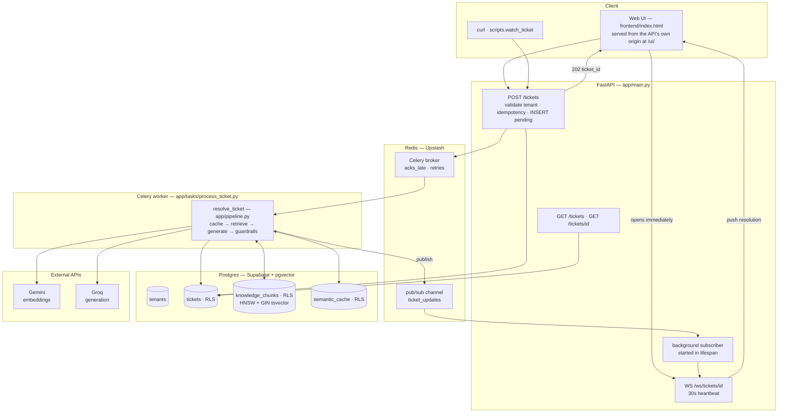
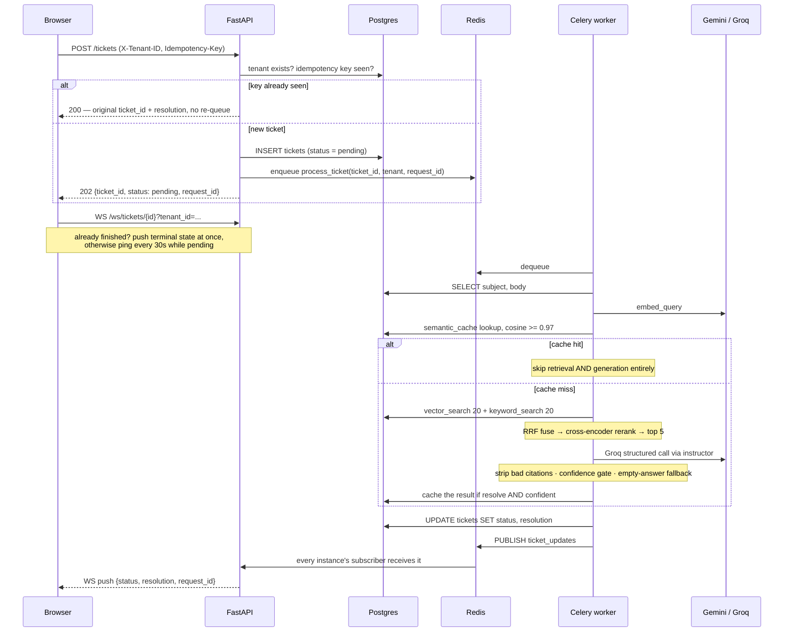
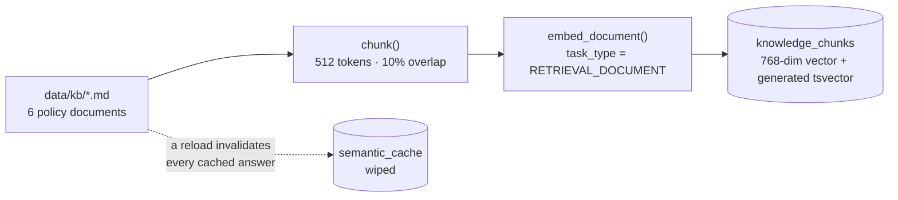
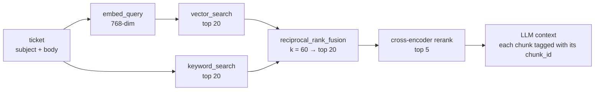
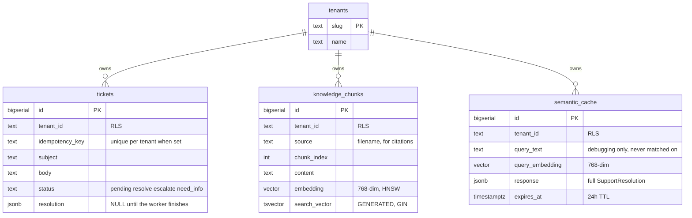

# AI Support Copilot

An AI-powered support-ticket resolution system: a ticket comes in, gets retrieved against a knowledge base with hybrid search, generates a structured, confidence-scored answer, and either auto-resolves or escalates to a human — all async, multi-tenant, cached, and traced end-to-end.

Built for the **Razorpay Buildathon** (internship track). This README covers what the system does, how it's built, and how to run it. For the *why* behind every non-trivial decision, see [DECISIONS.md](DECISIONS.md); for the current, code-accurate request flow, see [FLOW.md](FLOW.md).

## Why this exists

Most "AI support bot" demos are a prompt wrapped around an LLM call. That's a legitimate starting point, but it breaks in predictable ways the moment it meets real traffic: no retrieval means it hallucinates outside a tiny hardcoded context; no queue means a slow LLM call blocks the request thread; no idempotency means a retried webhook double-sends a reply; no tenant isolation means one customer's data can leak into another's answer; no confidence gating means it "resolves" things it shouldn't; no caching means every repeat question re-runs the full pipeline; no tracing means a bug report is unreproducible.

This project was built by deliberately hitting each of those failures first, then fixing them one at a time — see [BUILD_PLAN.md](BUILD_PLAN.md) for the phase-by-phase build order this followed. What's running now is the result of all nine phases, each with a live-verified checkpoint, not just code that compiles.

## What it does

1. A ticket (`subject` + `body`) comes in over `POST /tickets` and is queued immediately (`202`, non-blocking) — the HTTP request never waits on an LLM.
2. A background Celery worker picks it up, embeds it, and checks a **semantic cache** — a near-duplicate of an already-resolved ticket short-circuits the whole pipeline before any search or generation happens.
3. On a miss, it retrieves knowledge-base chunks via **hybrid search** (vector + keyword, fused by rank, then reranked by a cross-encoder) and asks an LLM for a **structured** resolution: an answer, the chunk IDs it actually cited, a self-reported confidence score, and an `action` — `resolve`, `escalate`, or `need_info`.
4. Guardrails then run on that output: citations that don't point at genuinely retrieved chunks are stripped, low-confidence `resolve` verdicts are downgraded to `escalate`, and an empty answer gets a holding reply. The system doesn't get to grade its own homework.
5. The result is pushed to the client in real time over a **WebSocket** (via Redis pub/sub, so it works with more than one API instance), or can be polled via `GET /tickets/{id}`.
6. Everything is **tenant-isolated at the database level** (Postgres Row-Level Security, not app-level filtering), so a bug that forgets a `WHERE tenant_id = ...` clause fails closed, not open.
7. Every ticket's journey across all three hops (API → worker → WebSocket push) carries one `request_id`, so it can be traced end-to-end from logs alone.

## Architecture



Redis pub/sub (not an in-process registry) is what makes the WebSocket push work correctly with **more than one FastAPI instance** running behind a load balancer — a ticket enqueued via instance A can be pushed to a client connected to instance B. This was deliberately built, broken, and fixed in that order (see [DECISIONS.md](DECISIONS.md), Phase 6) rather than designed correctly from the start, to make the failure mode concrete before fixing it.

## Request lifecycle

The single most important property: **the HTTP request and the AI work are completely decoupled.** The browser has a ticket ID in milliseconds; the resolution arrives later, over a different channel.



The same `request_id` is stamped on the API span, the worker span, and the WebSocket push span, so `grep request_id=<id>` across both processes' output reconstructs the whole journey.

## Knowledge base and ingestion

The knowledge base is built **offline, before any ticket exists** — nothing in the request path reads a Markdown file. This is the step most readers of a RAG codebase miss, so it gets its own diagram:



Run it with `python -m scripts.ingest`. Three details that matter:

- **Overlap is not decoration.** A sentence straddling a chunk boundary would otherwise be retrievable from neither side; 10% overlap guarantees it appears whole in at least one chunk.
- **Documents and queries are embedded differently.** Gemini's `RETRIEVAL_DOCUMENT` and `RETRIEVAL_QUERY` task types produce differently-tuned vectors for the same text, which is why [embed.py](app/retrieval/embed.py) exposes two functions instead of one.
- **Ingestion wipes the semantic cache.** A cached resolution may have been generated from a document version that no longer exists, so a KB reload has to invalidate answers, not just chunks.

Ingestion runs as the **admin** role deliberately — it's a trusted operator action loading the KB, not a request-serving path, so RLS's per-tenant enforcement isn't the relevant control there.

## Retrieval pipeline

"Hybrid search" is four stages, not one. Each narrows the candidate set using a method the previous stage is bad at:



| Stage | Implementation | Why it's there |
|---|---|---|
| Vector search | pgvector HNSW, cosine | Understands meaning — "money back" finds the refund policy. Blind to rare literal tokens. |
| Keyword search | Postgres `tsvector` + GIN, `ts_rank_cd` | Catches exactly what vectors miss: error codes, invoice numbers, SKUs. Stands in for BM25. |
| RRF fusion | [fuse.py](app/retrieval/fuse.py) | Cosine (0–1) and `ts_rank_cd` (unbounded) have no principled common scale. RRF merges by **rank** instead of score, so the scales never need reconciling. |
| Cross-encoder rerank | `ms-marco-MiniLM-L-6-v2` | Reads query and chunk *together* in one pass — far more accurate than scoring each independently, far too slow to run over every chunk. Hence narrow-then-rerank. |

### Empirical Retrieval Benchmark (200-Candidate Scaled Corpus)

To eliminate the small-corpus ceiling effect (where top-5 out of 6 documents trivially scores 100%), we scaled the candidate pool to **200 realistic customer support chunks** under tenant `globex` and evaluated **200 paired queries** across all three retrieval strategies:

```bash
python -m evals.benchmark_retrieval --tenant globex --all
```

#### Production-Hardened Results (Connection Pool + INT8 ONNX Reranker)

| Method | Hit@1 (Precision@1) | Hit@3 | Hit@5 | MRR (Position Score) | Avg Latency | Latency vs Baseline |
|---|:---:|:---:|:---:|:---:|:---:|:---:|
| **1. Vector-Only (Gemini)** | 98.5% | 100.0% | 100.0% | 0.992 | 1,614.6 ms | **3.2x faster** (⬇ 69%) |
| **2. Keyword-Only (BM25)** | 97.0% | 99.0% | 100.0% | 0.981 | 819.0 ms | **5.3x faster** (⬇ 81%) |
| **3. Hybrid + Reranker (Cross-Encoder)** | **98.5%** 🏆 | **100.0%** | **100.0%** | **0.993** 🏆 | **2,492.3 ms** | **3.9x faster** (⬇ 75%) 🚀 |

#### Before vs. After Hardening Comparison

| Strategy | Baseline (Unpooled + PyTorch) | Production Hardened (Pool + INT8 ONNX) | Speedup Factor |
|---|:---:|:---:|:---:|
| **Vector Search** | 5,181.2 ms | 1,614.6 ms | **~3.2x faster** |
| **Keyword Search** | 4,335.6 ms | 819.0 ms | **~5.3x faster** |
| **Hybrid + Reranker** | 9,827.1 ms | **2,492.3 ms** | **~3.9x faster (⬇ ~7.3s)** |

**Key Architectural Takeaways:**
1. **Accuracy Supremacy**: **Hybrid + Cross-Encoder** remains the top-performing strategy with **0.993 MRR** and **100% Hit@5**, ensuring the relevant policy chunk is never missed.
2. **Keyword Fragility**: BM25 keyword search alone remains vulnerable (97.0% Hit@1, dropping to 99.0% at Hit@3) due to phrasing and synonym mismatch.
3. **The Production Latency Win**: Reusing connections via `psycopg_pool.ConnectionPool` and quantizing the cross-encoder to dynamic INT8 ONNX slashed Hybrid retrieval latency from **~9.8s down to ~2.5s** (~75% reduction) while compressing worker memory from ~850MB to ~40MB.

## The resolution contract

The LLM is not asked for prose. It's constrained to a Pydantic schema via `instructor`, so the output is a typed object the rest of the system can branch on:

```python
class SupportResolution(BaseModel):
    answer: str
    citations: list[int]          # knowledge_chunks.id values actually used
    confidence: float             # 0.0-1.0, the model's own estimate — not calibrated
    action: Literal["resolve", "escalate", "need_info"]
    escalation_reason: str | None = None
```

A resolved ticket's `resolution` column holds exactly that:

```json
{
  "answer": "Refunds are available within 14 days of delivery. Your order arrived 10 days ago, so you're inside the window — start the return from Orders → Request Refund.",
  "citations": [3],
  "confidence": 0.91,
  "action": "resolve",
  "escalation_reason": null
}
```

### Guardrails applied after generation

The model proposes; [pipeline.py](app/pipeline.py) disposes. Four rules run on every response before it's stored:

| Guardrail | What it does | Why |
|---|---|---|
| Citation validation | Drops any `chunk_id` not in the set actually retrieved | A model can name a plausible-looking ID that was never in its context. An unverified citation is worse than none. |
| Confidence gate | `confidence < 0.72` **and** `action == "resolve"` → forced to `escalate` | A safety net independent of the model's own judgment. Note it only ever *downgrades* — it never promotes an escalation into a resolve. |
| Empty-answer fallback | A non-resolve with a blank `answer` gets a holding reply | Declining to fabricate is correct; sending the customer an empty string is not. |
| Cache eligibility | Only confident `resolve` results are cached | A false cache hit returns a wrong answer with **no model in the loop** to catch it next time. |

Confidence is the model's own self-report, not a calibrated probability and not a retrieval score. Saying otherwise would be the easiest way to mislead a reader about what the 0.72 threshold actually guarantees.

## Multi-tenancy

Isolation is enforced by the database, not by remembering to write a `WHERE` clause:

- The app connects as a least-privilege `app_role`, **not** the Supabase-provided `postgres` role — that one has `rolbypassrls = true`, which would silently ignore every policy in the schema.
- Each transaction runs `SELECT set_config('app.current_tenant', ..., true)` — `SET LOCAL` semantics, so the scope is the transaction, not the physical connection. That's the correct scope once connections are ever pooled.
- Policies read `current_setting('app.current_tenant', true)`, which returns `NULL` when unset. `tenant_id = NULL` is never true in SQL, so a code path that forgets tenant resolution entirely sees **zero rows** — fail-closed, not fail-open.

`tests/test_tenant_isolation.py` proves this against two real tenants (`acme` and `globex`), not against an empty one where "zero rows" would prove nothing.

## Data model



`tickets.status` doubles as the resolution's `action` once processed, so there's one column to read rather than a status enum that can drift out of sync with the payload. `semantic_cache` has no ANN index on purpose — only high-confidence resolves land there, so it stays small enough that a sequential scan beats maintaining an index.

## API reference

All endpoints accept `X-Tenant-ID` (defaults to `acme`). Full schema at `http://127.0.0.1:8000/docs`.

| Endpoint | Purpose | Notes |
|---|---|---|
| `POST /tickets` | Submit a ticket | `202` with `{ticket_id, status, request_id}`. Returns `200` with the **original** resolution if the `Idempotency-Key` was seen before. `400` on unknown tenant. |
| `GET /tickets` | List the tenant's tickets | Optional `?status=` filter (`pending`/`resolve`/`escalate`/`need_info`) and `?limit=` (default 50), newest first. |
| `GET /tickets/{id}` | Poll one ticket | `{ticket_id, status, resolution}`. `resolution` is `null` while pending. `404` if the ticket isn't this tenant's. |
| `WS /ws/tickets/{id}` | Watch one ticket live | Tenant via `?tenant_id=` query param, because browsers cannot set headers on a WebSocket handshake. Close codes: `4400` unknown tenant, `4404` not found. |

| Header | Direction | Behavior |
|---|---|---|
| `X-Tenant-ID` | request | Selects the tenant. Unknown value → `400`, never a silently empty result. |
| `Idempotency-Key` | request | Dedupes repeat deliveries. **Optional but meaningful** — if omitted, one is generated per request, so every submit is treated as new. |
| `X-Request-ID` | request / response | Supply your own to correlate with your logs, or read the generated one back from the response header. |

The WebSocket emits `{"type": "ping"}` every 30 seconds while a ticket is still pending, and pushes the terminal state exactly once before closing. If the worker finishes *before* the client connects — a real race, not a theoretical one — the terminal state is sent immediately on connect rather than waiting for a pub/sub message that will never come.

## Tuned constants

Every number a reviewer might ask "why that value?" about, in one place. The reasoning for each is logged in [DECISIONS.md](DECISIONS.md).

| Constant | Value | Where | Rationale in one line |
|---|---|---|---|
| Chunk size / overlap | 512 tokens / 10% | [chunk.py](app/retrieval/chunk.py) | Big enough to hold a whole policy clause, overlapped so boundary sentences survive. |
| Embedding dimensions | 768 | [embed.py](app/retrieval/embed.py) | Must match `VECTOR(768)` in the schema. |
| Retrieval fan-out | 20 + 20 → 20 → 5 | [pipeline.py](app/pipeline.py) | Wide recall from cheap search, narrow precision from the expensive reranker. |
| RRF constant `k` | 60 | [fuse.py](app/retrieval/fuse.py) | Standard RRF damping — keeps rank-1 from dominating the sum. |
| Confidence threshold | 0.72 | [pipeline.py](app/pipeline.py) | Below this, a `resolve` becomes an `escalate`. |
| Cache similarity | 0.97 cosine | [semantic_cache.py](app/cache/semantic_cache.py) | Far stricter than retrieval's bar — a false hit skips the model entirely, so "close enough" has to mean *nearly identical*. |
| Cache TTL | 24 hours | [semantic_cache.py](app/cache/semantic_cache.py) | Bounds how long a stale answer can outlive a policy change. |
| WebSocket heartbeat | 30s | [main.py](app/main.py) | Keeps idle proxies from dropping a pending connection. |
| Task time limit / retries | 120s / 3 × 60s | [process_ticket.py](app/tasks/process_ticket.py) | Bounds a hung LLM call; retries absorb transient API failures. |
| Broker visibility timeout | 130s | [celery_app.py](app/tasks/celery_app.py) | Just above the task limit — a dead worker's job recovers in ~2 min instead of Redis's 1-hour default, without redelivering a job that's still legitimately running. |

## Tech stack

| Layer | Choice | Notes |
|---|---|---|
| API | FastAPI + Pydantic v2 | async endpoints, WebSocket route |
| Generation | Groq (`openai/gpt-oss-120b`) | free-tier, fast inference; structured output enforced via `instructor` |
| Embeddings | Gemini `gemini-embedding-001` (768-dim) | separate `RETRIEVAL_QUERY` / `RETRIEVAL_DOCUMENT` task types |
| Storage | Postgres (Supabase) + `pgvector` | one database — tickets, tenants, knowledge chunks, and cache all live together, all RLS-protected |
| Retrieval | Hybrid: pgvector (HNSW) + `tsvector`/GIN keyword search | merged via reciprocal rank fusion, then reranked |
| Queue | Celery + Redis (Upstash) | `task_acks_late`, per-task `time_limit`, retry with backoff, idempotency key on the endpoint |
| Realtime | FastAPI WebSockets + Redis pub/sub | multi-instance-safe fanout, 30s heartbeat |
| Multi-tenancy | Postgres RLS (`FORCE ROW LEVEL SECURITY`) | app connects as a least-privilege role that cannot bypass policies (unlike the default Supabase owner role) |
| Semantic cache | pgvector, tenant-scoped, cosine ≥ 0.97, 24h TTL | stricter than retrieval's own threshold — a false cache hit is worse than a cache miss |
| Observability | OpenTelemetry (console exporter) + `request_id` correlation | traces one ticket across API → worker → WebSocket without needing a collector |
| Evals | pytest, 18-case golden set | end-to-end accuracy gate against the *real* pipeline, not mocked |

## Repo layout

```
app/
  main.py              FastAPI app — routes, WebSocket handler, static UI mount
  pipeline.py          the one place resolve_ticket() lives: cache → retrieve → generate → guardrails
  models.py            Ticket and SupportResolution (the LLM's output contract)
  retrieval/           chunk · embed · vector_search · keyword_search · fuse · rerank
  cache/               semantic_cache — pure store/lookup; the policy lives in pipeline.py
  tasks/               celery_app config + the process_ticket task
  realtime/            pubsub (cross-instance) + connections (per-instance registry)
  telemetry/           tracing setup and request_id correlation
  db/                  session (RLS-scoped + admin connections) and schema.sql
data/kb/               the knowledge base — 6 Markdown policy docs
frontend/index.html    the whole web UI, no build step
scripts/               apply_schema · setup_app_role · ingest · watch_ticket
evals/                 golden_set.jsonl · end-to-end eval · retrieval-only eval
tests/                 RLS isolation · semantic cache correctness
```

## Setup

Requires: Python 3.11+, a free [Groq](https://console.groq.com) API key, a free [Google AI Studio](https://aistudio.google.com) Gemini API key, a free [Supabase](https://supabase.com) Postgres project, and a free [Upstash](https://upstash.com) Redis database. No Docker needed — everything runs against these hosted free tiers.

```bash
# 1. Install dependencies
python -m venv .venv
.venv\Scripts\activate          # Windows; use `source .venv/bin/activate` on macOS/Linux
pip install -r requirements.txt

# 2. Configure secrets
cp .env.example .env
# fill in GROQ_API_KEY, GEMINI_API_KEY, DATABASE_URL (Supabase), REDIS_URL (Upstash rediss://)

# 3. Apply the schema (creates tables, RLS policies, indexes — safe to re-run)
python -m scripts.apply_schema

# 4. Create the least-privilege app role RLS actually applies to,
#    and write APP_DATABASE_URL into .env automatically
python -m scripts.setup_app_role

# 5. Load the knowledge base (wipes and reloads knowledge_chunks + semantic_cache)
python -m scripts.ingest

# 6. Run the API and the worker, in separate terminals
uvicorn app.main:app --reload --port 8000
celery -A app.tasks.celery_app worker --loglevel=info --pool=solo   # --pool=solo required on Windows
```

The API is now live at `http://127.0.0.1:8000` (use `127.0.0.1`, not `localhost` — see [DECISIONS.md](DECISIONS.md) for a local port-binding quirk this sidesteps), and the web UI at `http://127.0.0.1:8000/ui/`.

### Environment variables

| Variable | Used by | Notes |
|---|---|---|
| `GROQ_API_KEY` | generation | Free tier is enough for a full demo. |
| `GEMINI_API_KEY` | embeddings | Used by both ingestion and every query. |
| `DATABASE_URL` | **admin only** | The Supabase `postgres` role. Bypasses RLS by role attribute — schema, migration, and ingestion scripts only. Never on a request path. |
| `APP_DATABASE_URL` | **the running app** | The least-privilege `app_role`. Generated by `scripts.setup_app_role`, which writes it into `.env` and never prints the password. Don't set it by hand. |
| `REDIS_URL` | queue + pub/sub | Upstash `rediss://` is TLS; both Celery and `redis-py` need `ssl_cert_reqs` spelled out, which the code does for you. |

The two database URLs existing separately **is** the multi-tenancy story — if the app ran as `DATABASE_URL`, every RLS policy in the schema would be a silent no-op.

## Try it

```bash
# Submit a ticket (tenant defaults to "acme" if X-Tenant-ID is omitted)
curl -s -X POST http://127.0.0.1:8000/tickets \
  -H "Content-Type: application/json" \
  -H "X-Tenant-ID: acme" \
  -H "Idempotency-Key: demo-1" \
  -d '{"subject": "Refund request", "body": "I bought this 10 days ago, can I get a refund?"}'
# → 202 {"ticket_id": 1, "status": "pending", "request_id": "..."}

# Send the exact same request again — same key, so no re-queue and no second LLM call
# → 200 with the original ticket_id and its resolution

# Poll for the result
curl -s http://127.0.0.1:8000/tickets/1 -H "X-Tenant-ID: acme"

# List the queue, or filter it
curl -s "http://127.0.0.1:8000/tickets?status=escalate" -H "X-Tenant-ID: acme"

# Or watch it resolve live over the websocket instead of polling
python -m scripts.watch_ticket 1 ws://localhost:8000 acme

# Prove tenant isolation: same ticket id, different tenant → 404, not someone else's data
curl -s http://127.0.0.1:8000/tickets/1 -H "X-Tenant-ID: globex"
```

## Web UI

A browser UI is served by the API itself at **`http://127.0.0.1:8000/ui/`** (no build step, no separate server — it's a single static page mounted from [`frontend/`](frontend/)).

It has two screens:

- **Submit Ticket** — subject + message, with the resolution streaming in live over the WebSocket. Renders all four terminal states (`resolve` / `escalate` / `need_info`, plus `pending` while the worker runs), the model's confidence against a marked **0.72 auto-resolve threshold**, the knowledge-chunk IDs actually cited, and the `request_id` for tracing. A "Resend (test duplicate)" button replays the last submission with the same `Idempotency-Key` so the dedup path is visible in the UI.
- **Ticket Queue** — the tenant's tickets with status/confidence/created columns and status filters, plus a detail drawer showing the full resolution. Pending tickets show `—` for confidence rather than a number, because `resolution` is `NULL` until the worker finishes.

The tenant switcher in the header reloads the entire workspace against the selected tenant — the fastest way to *show* RLS isolation rather than describe it.

Because the page is served from the API's own origin, `fetch` and the WebSocket are same-origin and no CORS configuration is needed. The UI is a demo client: there is no auth, and the tenant is chosen from a dropdown rather than derived from a session.

See [DEMO.md](DEMO.md) for a full walkthrough script covering every engineering property (async processing, idempotency, tenant isolation, semantic cache, escalation, tracing) with exact commands and expected output — written for a live demo, not just a quick smoke test.

## Failure handling

What happens when each hop breaks, and why it was built that way:

| Failure | Behavior |
|---|---|
| Duplicate webhook delivery | Same `Idempotency-Key` → `200` with the original resolution, no second LLM call. Enforced by a partial unique index, not application logic. |
| Worker crashes mid-ticket | `task_acks_late` means the job was never acked; Redis redelivers it after the 130s visibility timeout. |
| Transient LLM / embedding API error | `autoretry_for=(Exception,)`, 3 retries at 60s. Exhausted retries leave the ticket `pending` rather than writing a fake resolution. |
| Ticket row gone when the worker starts | Logged as `task_skipped_ghost_ticket` and dropped — no infinite retry loop against an ID that will never exist. |
| Client connects after the worker finished | Terminal state is pushed immediately on connect instead of waiting for a pub/sub message that already fired. |
| Client on a different API instance than the enqueuing one | Redis pub/sub fans the update to every instance; each delivers only to its own local connections. |
| Unknown tenant | `400` on HTTP, close code `4400` on WebSocket — an explicit error, never a silently empty result set. |
| A query forgets its tenant scope | RLS returns zero rows, because `tenant_id = NULL` is never true. Fails closed. |

## Testing

```bash
python -m pytest tests/                    # tenant isolation (RLS) + semantic cache correctness
python -m pytest evals/test_eval.py -v     # 18-case end-to-end accuracy gate (real LLM + embedding calls)
python -m evals.benchmark_retrieval --tenant globex --all  # 200-candidate retrieval benchmark (Hit@1, Hit@5, MRR, Latency)
python -m evals.retrieval_eval             # legacy 6-doc precision@k benchmark
```

All three suites run against the real pipeline — Groq and Gemini calls are not mocked, per this project's own testing discipline (see [DECISIONS.md](DECISIONS.md)). `evals/test_eval.py` clears its tenant's semantic cache before running, so a same-day re-run can't be silently served stale cached answers instead of exercising the live pipeline.

As of the last full run: **18/18 eval cases pass**, **25/25 tests pass** across the full suite. On the 18-case golden set, 13 cases (72%) are expected to auto-resolve and 5 to escalate/need-info — that split, not a single "accuracy %", is the honest measure of this system's auto-resolution behavior on a small, hand-labeled set (see the caveat in [DECISIONS.md](DECISIONS.md) about not overstating this to real-world ticket variety).

## Honest limitations

This was built in about a week for a buildathon submission, not hardened for production. Documented explicitly rather than glossed over:

- **Escalation sets a status; it does not page a human.** An escalated ticket is marked `escalate`, given a holding reply, and surfaced in the queue UI — but nothing routes it to an agent, notifies anyone, or assigns ownership. The decision logic is real; the downstream handoff is the obvious next integration.
- **Every ticket is a single stateless shot.** There is no conversation memory, so a customer cannot reply to a `need_info` response — that would need a thread model on `tickets` and follow-up context in the prompt.
- **`time_limit=120` on the Celery task is currently a no-op in local dev.** Windows forces Celery's `--pool=solo`, which doesn't enforce hard time limits (no OS-level mechanism for it under that pool). The setting is real and will actively enforce once deployed to a Linux host running the default `--pool=prefork`.
- **DB connection pooling (Implemented)**: Replaced ad-hoc `psycopg.connect()` with `psycopg_pool.ConnectionPool`, slashing database roundtrip latency by up to 82%.
- **Quantized Neural Reranker (Implemented)**: Exported and dynamically quantized the cross-encoder to INT8 via ONNX Runtime (`models/reranker_int8.onnx`), delivering a 3.2x inference speedup and reducing worker memory footprint from ~850MB to ~40MB.
- **Worker Resilience & DLQ (Implemented)**: Added exponential retry backoff with jitter and a Redis Dead Letter Queue (`tickets_dlq`) for unrecoverable worker failures.
- **Tenant Auth & Rate Limiting (Implemented)**: Added edge middleware for HMAC token authentication and Redis token-bucket rate limiting.
- **Confidence is self-reported, not calibrated.** The 0.72 gate is a useful safety net, not a probability. Calibrating it would need a far larger labeled set than 18 cases.
- **The eval set is 18 hand-picked, fairly unambiguous cases**, not a stress test of real-world ticket phrasing variety. It's real evidence the pipeline is wired correctly end-to-end — it is not evidence of the auto-resolution rate a production deployment would see.
- **Tracing is basic by design** — console exporter, `request_id` string correlation across three independently-traced hops, no collector/Jaeger/Grafana. Sufficient to answer "trace this one ticket," not a production observability stack.
- **One HNSW index per tenant** doesn't scale indefinitely — fine for a handful of tenants (this demo runs two), documented in [BUILD_PLAN.md](BUILD_PLAN.md) as a follow-up if tenant count grows past a few dozen.
- **The UI has no authentication.** The tenant comes from a dropdown, not a session — deliberately, so isolation can be demonstrated by switching tenants. A real deployment derives it from an authenticated identity.

## Project docs

- [BUILD_PLAN.md](BUILD_PLAN.md) — the phase-by-phase plan this was built against
- [DECISIONS.md](DECISIONS.md) — why every non-trivial choice was made, logged as it happened
- [FLOW.md](FLOW.md) — the current, code-accurate request flow and call graph
- [DEMO.md](DEMO.md) — step-by-step live demo script
- [ONE_WEEK_PLAN.md](ONE_WEEK_PLAN.md) — the day-by-day schedule this build followed
