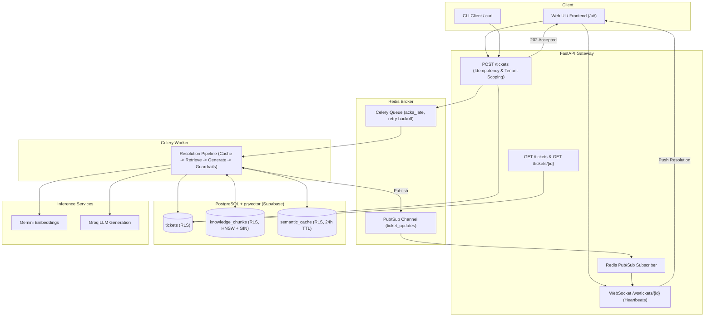
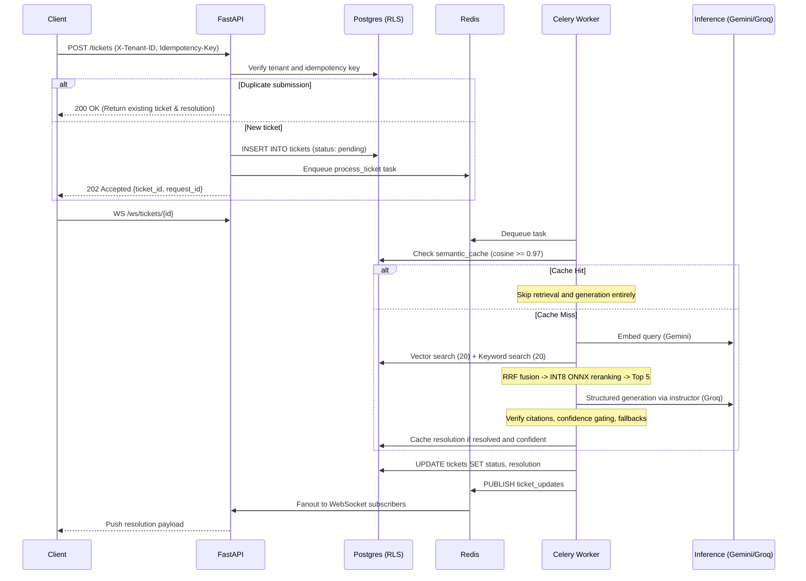
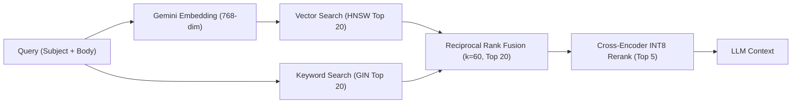
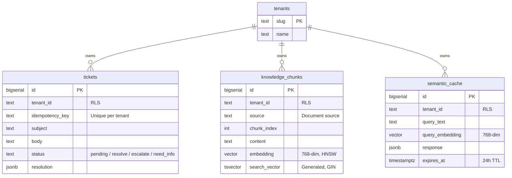

# AI Support Copilot

An asynchronous, multi-tenant customer support ticket resolution engine. Incoming tickets are queued immediately, retrieved against a knowledge base via hybrid search, reranked with an INT8 quantized cross-encoder, and evaluated by an LLM with structured outputs and citation guardrails.

---

## System Architecture



---

## Key Capabilities

1. **Non-Blocking Ingestion**: `POST /tickets` validates tenant scope and idempotency keys, writes the row, and returns `202 Accepted` in ~150 ms. Work is processed asynchronously by Celery.
2. **Database-Enforced Multi-Tenancy**: Tenant isolation is enforced via PostgreSQL Row-Level Security (`FORCE ROW LEVEL SECURITY`) under a restricted `app_role`. Unscoped queries return zero rows (fail-closed).
3. **Semantic Cache**: Pre-computed query embeddings short-circuit near-duplicate queries using cosine similarity (threshold >= 0.97, 24h TTL) in PostgreSQL, avoiding redundant LLM calls.
4. **Hybrid Retrieval**: Combines pgvector semantic search (HNSW) and full-text keyword search (`tsvector` + GIN) via Reciprocal Rank Fusion (k=60), followed by neural reranking.
5. **INT8 Quantized Reranker**: The cross-encoder (`ms-marco-MiniLM-L-6-v2`) runs as a dynamic INT8 ONNX model, reducing memory from ~850 MB to ~40 MB and cutting inference time to ~16 ms per batch.
6. **Structured Output & Guardrails**: The LLM outputs strict JSON validated against a Pydantic schema (`SupportResolution`). Post-generation guardrails strip hallucinated citation IDs, force low-confidence resolutions (< 0.72) to escalate, and inject holding answers for empty replies.
7. **Cross-Instance Realtime Streaming**: Terminal resolution states fan out through Redis Pub/Sub, allowing WebSockets to deliver updates across multiple load-balanced API instances.
8. **End-to-End Tracing**: A consistent `request_id` correlates the API request, queue handoff, worker execution, and WebSocket delivery.

---

## Request Lifecycle



---

## Retrieval Pipeline & Benchmarks

The retrieval pipeline narrows candidate chunks in four sequential stages:



### Retrieval Evaluation (200 Chunks, 200 Queries)

Evaluated under tenant `globex` against 200 distractor chunks to eliminate corpus ceiling effects:

```bash
python -m evals.benchmark_retrieval --tenant globex --all
```

#### Production Benchmark Results

| Method | Hit@1 (P@1) | Hit@3 | Hit@5 | MRR | Latency |
|---|:---:|:---:|:---:|:---:|:---:|
| **1. Vector-Only (Gemini)** | 98.5% | 100.0% | 100.0% | 0.992 | 1,614.6 ms |
| **2. Keyword-Only (BM25)** | 97.0% | 99.0% | 100.0% | 0.981 | 819.0 ms |
| **3. Hybrid + Reranker (Cross-Encoder)** | **98.5%** | **100.0%** | **100.0%** | **0.993** | **2,492.3 ms** |

#### Performance Gains: Baseline vs. Production Hardened

| Pipeline Strategy | Baseline (Unpooled + PyTorch) | Hardened (Pool + INT8 ONNX) | Speedup Factor |
|---|:---:|:---:|:---:|
| **Vector Search** | 5,181.2 ms | 1,614.6 ms | 3.2x faster (-69%) |
| **Keyword Search** | 4,335.6 ms | 819.0 ms | 5.3x faster (-81%) |
| **Hybrid + Reranker** | 9,827.1 ms | **2,492.3 ms** | **3.9x faster (-75%)** |
| **Reranker Memory** | ~850 MB | **~40 MB** | **20x lighter** |

---

## Resolution Contract & Guardrails

The LLM is constrained to a typed Pydantic schema using `instructor`:

```python
class SupportResolution(BaseModel):
    answer: str
    citations: list[int]          # Validated chunk IDs
    confidence: float             # Model confidence estimate (0.0 - 1.0)
    action: Literal["resolve", "escalate", "need_info"]
    escalation_reason: str | None = None
```

### Post-Generation Guardrails

| Guardrail | Enforcement Rule | Rationale |
|---|---|---|
| **Citation Verification** | Drop any `chunk_id` not retrieved in context | Strips hallucinated IDs from the response. |
| **Confidence Gate** | `confidence < 0.72` and `action == "resolve"` forced to `escalate` | Prevents borderline model decisions from auto-resolving. |
| **Empty Answer Fallback** | Non-resolves with empty answers receive default holding text | Avoids customer-facing blank replies on escalations. |
| **Cache Gate** | Only confident `resolve` responses are stored in `semantic_cache` | Prevents inaccurate or unresolved responses from persisting. |

---

## Database Architecture



---

## API Reference

Interactive documentation is available at `http://127.0.0.1:8000/docs`.

| Endpoint | Method | Description |
|---|---|---|
| `/tickets` | `POST` | Enqueues a ticket. Returns `202 Accepted` with `ticket_id`. Returns `200 OK` on repeated `Idempotency-Key`. |
| `/tickets` | `GET` | Lists tenant tickets. Supports `?status=` and `?limit=` filters. |
| `/tickets/{id}` | `GET` | Fetches ticket status and resolution. Scoped by RLS. |
| `/ws/tickets/{id}` | `WS` | Real-time WebSocket connection. Emits 30s heartbeats and pushes final resolution. |
| `/healthz` | `GET` | Liveness probe. |
| `/readyz` | `GET` | Readiness probe for PostgreSQL pool and Redis connectivity. |

### Request Headers

| Header | Scope | Function |
|---|---|---|
| `X-Tenant-ID` | Request | Tenant routing key (defaults to `acme`). |
| `Idempotency-Key` | Request | Deduplicates incoming webhooks and requests. |
| `X-Request-ID` | Both | Distributed correlation ID across logs and spans. |

---

## Tuned System Constants

| Parameter | Value | Location | Engineering Reason |
|---|---|---|---|
| **Chunk Size / Overlap** | 512 tokens / 10% | `app/retrieval/chunk.py` | Preserves context across chunk boundaries. |
| **Embedding Vector Size** | 768 dimensions | `app/retrieval/embed.py` | Matches Gemini `text-embedding-004` output. |
| **Retrieval Fan-Out** | 20 + 20 -> 20 -> 5 | `app/pipeline.py` | Wide initial recall, narrow reranked context. |
| **RRF Constant k** | 60 | `app/retrieval/fuse.py` | Damps top-rank bias in reciprocal rank fusion. |
| **Confidence Threshold** | 0.72 | `app/pipeline.py` | Minimum threshold for automated ticket resolution. |
| **Semantic Cache Match** | 0.97 cosine | `app/cache/semantic_cache.py` | Strict cutoff to prevent false hits on adversarial questions. |
| **Cache TTL** | 24 hours | `app/cache/semantic_cache.py` | Limits duration of cached responses after policy changes. |
| **Broker Visibility Timeout** | 130 seconds | `app/tasks/celery_app.py` | Exceeds 120s task limit to prevent redundant re-queuing. |

---

## Setup & Running

### Prerequisites
- Python 3.11+
- Hosted PostgreSQL with `pgvector` (e.g. Supabase)
- Hosted Redis with TLS (e.g. Upstash)
- API Keys: Google AI Studio (Gemini) and Groq

```bash
# 1. Clone and install dependencies
python -m venv .venv
source .venv/bin/activate
pip install -r requirements.txt

# 2. Configure environment variables
cp .env.example .env
# Set GROQ_API_KEY, GEMINI_API_KEY, DATABASE_URL, and REDIS_URL

# 3. Apply schema and create RLS application role
python -m scripts.apply_schema
python -m scripts.setup_app_role

# 4. Ingest knowledge base
python -m scripts.ingest

# 5. Export INT8 ONNX reranker model (optional if already exported)
python -m scripts.export_reranker_onnx

# 6. Start API server and Celery worker
uvicorn app.main:app --reload --port 8000
celery -A app.tasks.celery_app worker --loglevel=info --pool=solo
```

The Web UI is served at `http://127.0.0.1:8000/ui/`.

---

## Testing

```bash
# Run unit, RLS isolation, and pooling tests
python -m pytest tests/

# Run 18-case end-to-end accuracy gate (real LLM calls)
python -m pytest evals/test_eval.py -v

# Run 200-candidate retrieval benchmark
python -m evals.benchmark_retrieval --tenant globex --all
```
